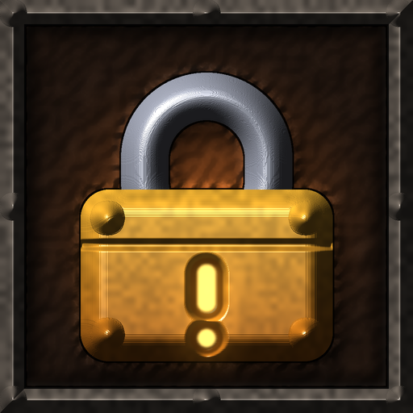
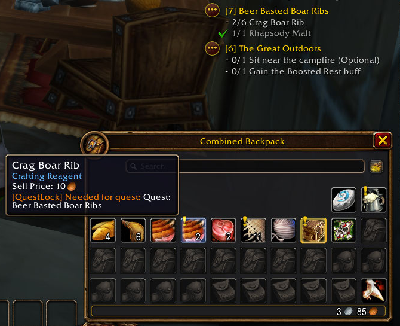
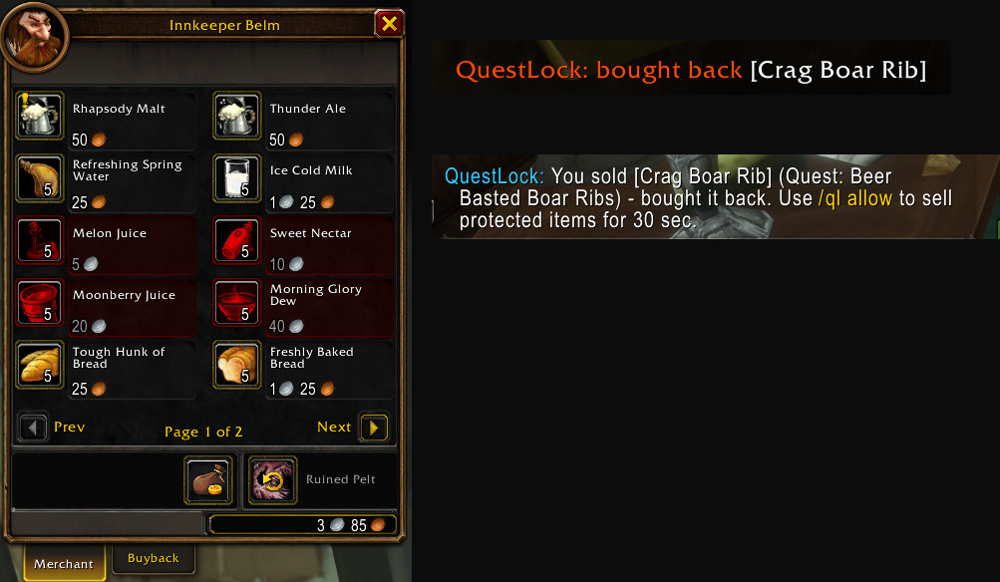
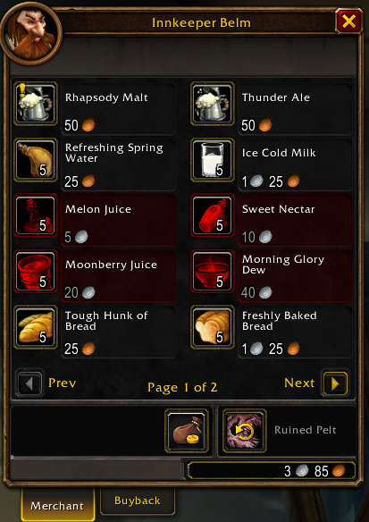

# QuestLock Forever

Never sell or delete a quest item by mistake again.

Early quests often ask for plain white items like Chunk of Boar Meat, Spider Ichor or Linen Cloth. They look like vendor trash, so it's easy to sell or destroy them right before you need them. QuestLock Forever protects these items, and your profession tools too.

## Features

- **Reads your quest log.** Any item a quest in your log asks for is protected automatically. When an objective is done it stays protected until you hand the quest in.
- **Delete warning.** The delete box shows a red warning, plays a sound and locks the Yes button for a few seconds.
- **Automatic buyback.** If you sell a protected item, QuestLock buys it back instantly. You get your item back and lose no money.
- **Icons.** A yellow `!` marks quest items and a padlock marks profession tools and items you added yourself. They show in your bags, at vendors and in the loot window.
- **Baganator support.** The icon appears as a Baganator corner widget.
- **Profession tools.** Skinning Knife, Mining Pick, Blacksmith Hammer, Arclight Spanner, enchanting rods and fishing poles are protected.
- **Your own list.** Drag any item onto the drop zone in the options to protect it.
- **Tooltip line.** Hover over a protected item to see why it's protected.

## Options

Open with `/ql` or **Options → AddOns → QuestLock Forever**.

## Commands

| Command | What it does |
|---|---|
| `/ql` | Open the options |
| `/ql add [item]` | Protect an item (shift-click it into chat) |
| `/ql remove [item]` | Stop protecting an item |
| `/ql allow` | Allow selling protected items for 30 seconds |
| `/ql list` | Show everything that's protected |
| `/ql help` | Show all commands |
| `/qldebug` | Show what QuestLock found in your quest log |

## Known issues

- The WoW Forever beta may not keep addon settings after a full game restart. If your options or your own item list reset, that's the client, not the addon.
- Bag addons other than Baganator (like Bagnon or AdiBags) don't show the icons yet. Protection, tooltips and buyback still work.
- WoW doesn't let addons block a sale, so QuestLock buys the item back right after instead.

## Bug reports

Please include your version (`/ql help`), the output of `/qldebug`, and any Lua error text.

## Install

Copy the files into `World of Warcraft\_forever_\Interface\AddOns\QuestLockForever\`, then `/reload`.

## Screenshots

